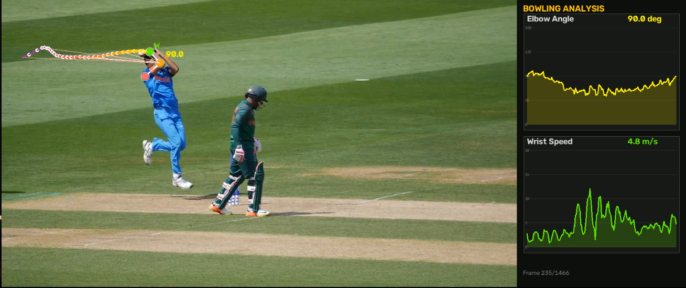
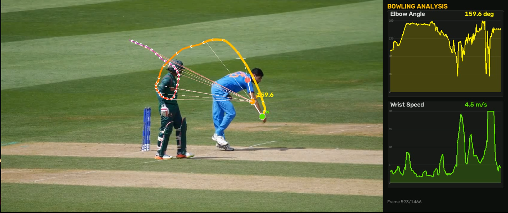

<div align="center">

# 🏏 Cricket Bowling Biomechanics

### AI-powered pose analysis for cricket bowlers

[](https://www.python.org)
[](https://docs.ultralytics.com/tasks/pose)
[](https://pytorch.org)
[](https://opencv.org)
[](#-license)

Detect bowling-arm pose landmarks and analyse the shoulder–elbow–wrist movement using a custom YOLO pose model.

</div>

<p align="center">
  
  
</p>

<p align="center"><i>Pose prediction examples from the trained bowler model</i></p>

---

## ✨ What This Project Does

This project builds an end-to-end computer vision pipeline for cricket bowling biomechanics:

- 🎥 Extracts frames from a cricket bowling video
- 🖍️ Annotates bowler pose landmarks in CVAT
- 🔄 Converts CVAT annotations to COCO and YOLO-Pose formats
- 🧠 Fine-tunes a YOLOv8 pose model
- 📐 Detects **shoulder, elbow, and wrist** landmarks
- 📊 Supports analysis of bowling-arm position and movement
- 🎯 Provides a ready-to-use trained model at `best.pt`

## 📸 Keypoint Model

The model predicts one bowler and three arm landmarks:

| ID | Landmark | Visual | Purpose |
|---:|---|:---:|---|
| 0 | Shoulder | 🟢 | Upper-arm reference |
| 1 | Elbow | 🔵 | Joint angle reference |
| 2 | Wrist | 🔴 | Bowling-arm trajectory and release reference |

```text
Shoulder ───── Elbow ───── Wrist
   0             1             2
```

> The pose configuration uses a `kpt_shape` of `[3, 3]`, meaning three keypoints with X, Y, and visibility values.

## 🚀 Quick Start

### 1. Clone or open the project

```bash
cd cricket
```

### 2. Create an environment

```bash
python -m venv .venv
source .venv/bin/activate
python -m pip install --upgrade pip
pip install ultralytics opencv-python pillow numpy tqdm
```

### 3. Run inference with the trained model

```python
from ultralytics import YOLO

model = YOLO("best.pt")
results = model.predict(
    source="clip.mp4",
    conf=0.25,
    save=True,
)
```

For a single image:

```python
model.predict(source="frames/clip_frame_001236_t24.72s_000070.jpg", conf=0.25, save=True)
```

To launch the result in a notebook:

```bash
jupyter notebook "BioMechanics Vision of Bowler.ipynb"
```

## 📁 Project Structure

```text
cricket/
├── 1.png                              # Example result
├── 2.png                              # Example result
├── best.pt                            # Trained YOLO pose weights
├── clip.mp4                           # Source bowling video
├── annotations.xml                    # CVAT point annotations
├── coco_annotations.json              # Converted COCO keypoints
├── bowling_pose.yaml                  # YOLO pose dataset configuration
├── cvat_to_coco_keypoints.py          # CVAT XML → COCO JSON
├── coco_to_yolo_pose.py               # COCO JSON → YOLO-Pose labels
├── BioMechanics Vision of Bowler.ipynb# Main workflow notebook
├── frames/                            # Extracted video frames
└── labels/                            # YOLO-Pose annotation files
```

## 🔄 Annotation and Training Workflow

```text
Bowling Video
     │
     ▼
Frame Extraction ──────────► 100 training frames
     │
     ▼
CVAT Point Annotation ─────► Shoulder, Elbow, Wrist
     │
     ▼
CVAT XML
     │
     ├─ cvat_to_coco_keypoints.py ──► COCO keypoints JSON
     │                                     │
     │                                     ▼
     └─ coco_to_yolo_pose.py ───────► YOLO-Pose labels
                                           │
                                           ▼
                                    85/15 train/validation split
                                           │
                                           ▼
                                   YOLOv8x-Pose fine-tuning
                                           │
                                           ▼
                                      best.pt
```

## 🛠️ Dataset Conversion

### Convert CVAT XML to COCO

```bash
python cvat_to_coco_keypoints.py annotations.xml coco_annotations.json
```

The converter:

- Reads `shoulder`, `elbow`, and `wrist` point labels
- Handles missing landmarks with `0, 0, 0`
- Records occluded points with visibility value `1`
- Records visible points with visibility value `2`
- Builds a padded bounding box around the annotated joints

### Convert COCO to YOLO-Pose

```bash
python coco_to_yolo_pose.py coco_annotations.json labels
```

Each YOLO-Pose label line contains:

```text
class_id  box_x  box_y  box_width  box_height  shoulder_x  shoulder_y  shoulder_vis  elbow_x  elbow_y  elbow_vis  wrist_x  wrist_y  wrist_vis
```

All coordinates are normalized to the range `0–1`.

## 🧪 Training Configuration

The training setup is captured in `bowling_pose.yaml`:

```yaml
names:
  0: bowler
kpt_shape: [3, 3]
flip_idx: [0, 1, 2]
train: train/images
val: val/images
```

A typical fine-tuning command is:

```python
from ultralytics import YOLO

model = YOLO("yolov8x-pose.pt")
model.train(
    data="bowling_pose.yaml",
    epochs=100,
    imgsz=640,
    batch=8,
    device=0,
)
```

## 📊 Dataset Summary

| Item | Count |
|---|---:|
| Extracted frames | 100 |
| Training frames used in notebook | 85 |
| Validation frames used in notebook | 15 |
| Keypoints per bowler | 3 |
| Bowler class | 1 |

## 📐 Possible Biomechanics Insights

Once predictions are collected over time, they can support:

- 🦾 Bowling-arm shoulder–elbow–wrist angle analysis
- 📈 Joint trajectory visualisation
- ⏱️ Delivery-phase segmentation
- 🔁 Release-point timing estimation
- 📉 Consistency checks across repeated deliveries
- 🎬 Overlay of pose landmarks on video or frames

> ⚠️ These predictions are a visual analysis aid, not a medical or coaching diagnosis. Validate biomechanical conclusions against high-quality video and an appropriate sports-science workflow.

## ⚙️ Requirements

- Python 3.10+
- Ultralytics
- PyTorch
- OpenCV
- Pillow
- NumPy
- tqdm
- Jupyter Notebook

## 🧩 Tips for Better Results

- Keep the bowler clearly visible and unobstructed
- Use consistent camera height and frame rate
- Capture more delivery phases across different angles
- Increase the number of annotated frames
- Improve wrist and elbow annotations around fast movement
- Use more training epochs and appropriate augmentation for limited datasets
- Review false annotations in CVAT before retraining

## 🤝 Contributing

Contributions are welcome. You can improve the project by:

1. Adding more bowling deliveries
2. Improving keypoint annotations
3. Experimenting with model variants
4. Adding angle and trajectory calculations
5. Building a polished video overlay interface

## 📜 License

Add a license file when you publish this project. Until then, treat the repository and trained weights as project-specific assets.

---

<div align="center">

**Built for cricket pose analysis and biomechanics research** 🏏

</div>
